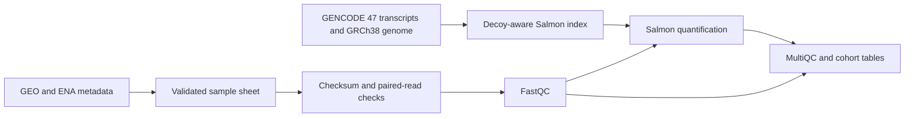

# NSCLC organoid RNA-seq workflow

Read quality assessment and transcript quantification for public NSCLC organoid sequencing data from [SRP158722](https://www.ncbi.nlm.nih.gov/sra?term=SRP158722) and [GSE119004](https://www.ncbi.nlm.nih.gov/geo/query/acc.cgi?acc=GSE119004).

The workflow joins documented organoid samples to ENA run files, verifies paired reads, runs FastQC, quantifies transcripts with Salmon, and produces a cohort report with MultiQC. Bash entry points support local execution and Slurm job dependencies. Python handles metadata validation, file integrity and report tables.

**Status — workflow implemented and tested with synthetic fixtures. Real FASTQ processing, reference indexing and transcript quantification are pending an HPC run.** The repository contains no measured mapping rates or abundance results from this study yet.

## Cohort

Nine GEO records are explicitly annotated as organoids. Each has one paired-end RNA-seq run, confirmed through its SRA experiment and BioSample identifiers. Their compressed FASTQ files total **35.55 GiB**.

The first run uses a smaller pilot cohort.

| GEO sample | Submitted title | Run |
|---|---|---|
| GSM3356477 | PDO54 | SRR7749979 |
| GSM4063806 | LPTO85_org | SRR10075656 |
| GSM4063812 | XDO137 | SRR10075662 |

The pilot contains **7.15 GiB** of compressed reads. It was selected to exercise the workflow across three documented organoid records while limiting the initial download. Selection provides no evidence of patient matching or biological replication.

## Workflow



- Pin reference URLs and provider checksums in `config/reference.json`.
- Construct a transcriptome with primary-genome decoys and index it with Salmon.
- Verify each compressed FASTQ against its ENA checksum and byte count.
- Stream both FASTQ files to verify record structure, mate names and fragment counts.
- Run FastQC, then Salmon with automatic library detection, sequence and GC bias correction, and 30 bootstrap replicates.
- Compare Salmon's processed-fragment count with the paired-read count, validate abundance tables, and collect review flags.
- Merge transcript TPM and estimated-count tables without stripping versioned transcript identifiers.
- Build a MultiQC report using only the selected cohort's completed outputs.

Completed stages have signatures and output checksums. Matching stages can be reused. Incomplete stages remain separate from completed output directories, and locks prevent two workers from writing the same stage.

## Set up on Linux or an HPC cluster

The environment pins FastQC 0.12.1, Salmon 1.10.2, MultiQC 1.25.1 and Python 3.11.11. Package solving and real tool execution still need verification on the target Linux system.

```bash
conda env create -f environment.yml
conda activate nsclc-rnaseq
python3 -m unittest discover -s tests -v
bash run.sh preflight --require-tools
```

The preflight command reports input size, available storage and detected executables. Plan for approximately **68 GiB of shared workspace for the pilot** or **96 GiB for the full cohort**, plus the software environment and operational headroom. These are conservative planning estimates. Reference indexing requests 48 GiB RAM in the Slurm profile; actual peak usage has not been measured.

Use a persistent shared project or scratch location accessible to every job. Scratch retention and cluster limits should be checked before starting a run.

## Submit to Slurm

Activate the environment before submission so the worker jobs inherit its executable paths.

```bash
# Optional when required by the cluster
export SLURM_ACCOUNT=your_account
export SLURM_PARTITION=your_partition

bash submit-slurm.sh config/pilot.tsv /shared/scratch/your_user/nsclc-rnaseq
```

This submits a reference job, a quantification array with at most two simultaneous workers, and a report job. Each stage depends on successful completion of its prerequisites. Job IDs are printed at submission. No cluster jobs have been submitted as part of the current validation.

For all nine runs, substitute `config/cohort.tsv`. Adjust time, memory and concurrency requests in `submit-slurm.sh` to the target cluster's limits.

## Run stages directly

```bash
bash run.sh reference --work-dir /shared/scratch/your_user/nsclc-rnaseq
bash run.sh quant --task 1 --samples config/pilot.tsv --work-dir /shared/scratch/your_user/nsclc-rnaseq
# Run tasks 2 and 3 before producing the report
bash run.sh summarize --samples config/pilot.tsv --work-dir /shared/scratch/your_user/nsclc-rnaseq
```

`--task` is the one-based data row of the sample sheet. Keep the same work directory and configuration across the stages.

## Outputs

| Location under the work directory | Contents |
|---|---|
| `reference/<signature>/` | Reference FASTA, decoys, Salmon index and provenance |
| `quant/<sample>/<signature>/fastqc/` | Per-mate FastQC HTML and ZIP reports |
| `quant/<sample>/<signature>/salmon/` | `quant.sf`, inferential replicates, library format and mapping metadata |
| `quant/<sample>/<signature>/metrics.json` | Parsed abundance and fragment checks, with review flags |
| `reports/<signature>/multiqc_report.html` | Cohort quality summary |
| `reports/<signature>/sample_qc.tsv` | Run identifiers, mapping metrics and FastQC status counts |
| `reports/<signature>/transcript_tpm.tsv` | Transcript TPM matrix |
| `reports/<signature>/transcript_estimated_counts.tsv` | Fractional estimated fragment-count matrix |
| `complete.json` within each completed stage | Input/configuration provenance and output checksums |

## Validation and interpretation

The automated tests cover metadata joins, corrupt downloads, paired-read mismatches, reference identifiers, numerical outputs, checkpoint integrity and stage orchestration. The orchestration test substitutes external tools with explicit synthetic stubs. See [validation status](docs/validation_status.md) for the boundary between software tests and pending sequencing analysis.

FastQC warnings and a low mapping rate prompt review. RNA-seq duplication and sequence-composition flags can reflect biology or library preparation. Thresholds in `config/qc.json` are review conventions and never remove samples automatically.

TPM supports within-sample relative abundance inspection. Estimated counts are fractional model estimates. Between-sample differential expression requires an appropriate experimental design and a separate statistical workflow. A human reference alone cannot characterize mouse contamination in xenograft-derived material.

See [methods and decisions](docs/methods.md) for reference scope, cohort selection and interpretation. Raw reads, reference files, generated analysis outputs and personal study notes are excluded from publication.

## Refresh metadata

```bash
python3 workflow/discover.py --out /path/to/a/review-copy
```

Review the generated tables before replacing the pinned sample sheets. Discovery requires the expected nine organoid records, verifies the BioSample links and rejects unexpected run multiplicity. Source URLs and SHA-256 values are recorded in `data/metadata/provenance.json`.
